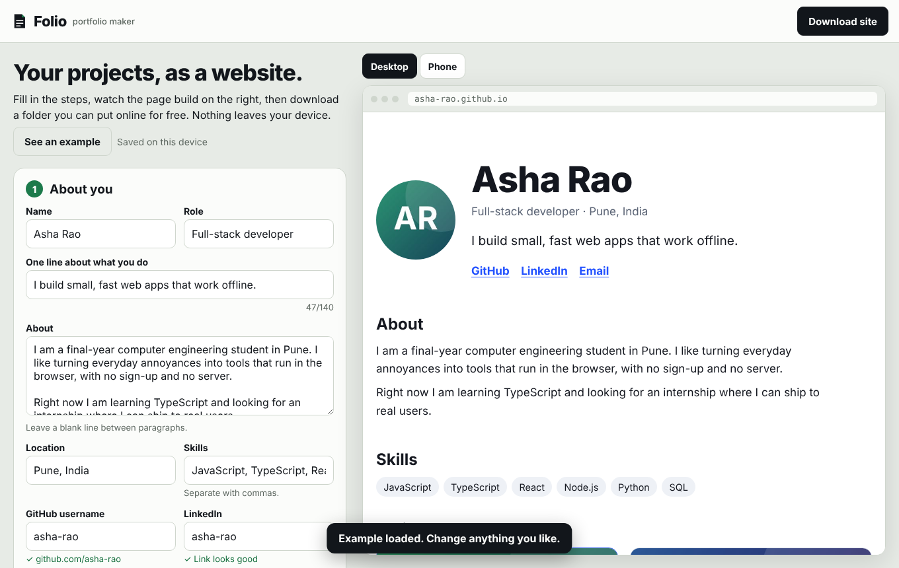
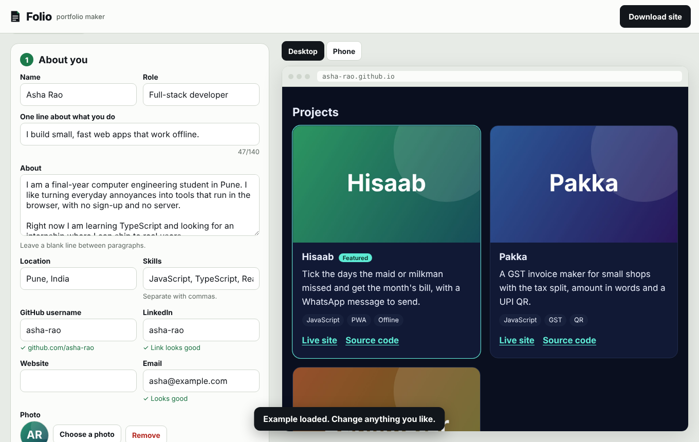
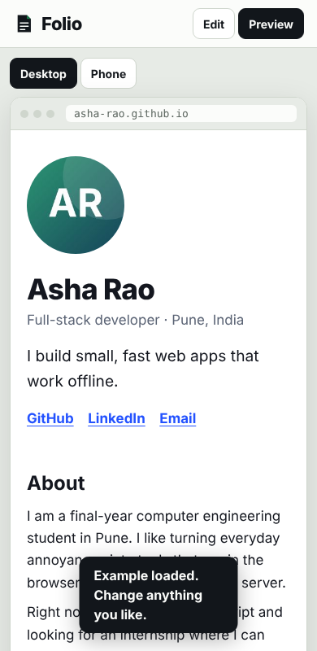

# Folio

Turn your projects into a portfolio website you can host for free. Fill in a short form, watch the page build beside it, then download a folder of plain HTML and CSS to put online.

**Try it:** https://jay-m007.github.io/Folio/ (tap "See an example" to look around)

| The builder | A finished site | On a phone |
|---|---|---|
|  |  |  |

## What it does

- **Four short steps.** About you, projects, look, put it online. A live preview beside the form updates as you type, in desktop or phone width.
- **Import from GitHub.** Type a username and pick which public repositories to add. Forks and archived repos are left unticked and your profile repo is skipped. It can also fill empty profile fields (name, bio, location, website).
- **Screenshots and a photo.** Choose a file and it is cropped or shrunk in your browser to a small JPEG. Nothing is uploaded.
- **Three themes.** Clean, Midnight and Journal, each responsive.
- **A site you own.** The download is a zip with `index.html`, `style.css`, your images and a README with the steps to publish on GitHub Pages. It has no scripts, no trackers and no dependencies, and works on any static host (GitHub Pages, Netlify, Cloudflare Pages).
- **A to-do list.** It tells you what is still missing, such as a project with no link.
- **Yours to keep.** Autosaves in your browser. Back up and restore as JSON.

## Privacy

Everything runs in your browser and is saved only on your device. There is no server and no account. The page's security policy blocks all network requests except one: when you press "Look up" in the GitHub import, the username is sent to GitHub's public API to list repositories, with no cookies and no referrer. Photos and screenshots never leave the page. Because nothing is stored elsewhere, keep a backup if you clear your browser data.

## How it works

Pages and links are built from validated values only. All text is escaped. A link must be `http` or `https`, so `javascript:` and `data:` links are dropped, and images must be real small JPEG, PNG or WebP data. The zip writer is about 40 lines of code with no library; the output was checked with the system `unzip`. The live preview renders the same HTML and CSS that go into the zip, inside a shadow root, so what you see is what you download.

```
engine/   model.js (data and limits), site.js (HTML and themes), github.js, zip.js, util.js
web/      the page: index.html, style.css, app.js, sample.js
tests/    node --test
```

## What it is not

It does not host your site for you, and it does not edit the site after you download it. To change something, change it here and download again, or edit the HTML by hand. The GitHub import uses GitHub's anonymous API, which allows about 60 requests an hour per network.

## Run it yourself

```
npm test          # 22 tests
npm run serve     # builds, then open http://localhost:8080
```

No build tools or packages to install; it needs Node 20 or newer. Pushing to `main` runs the tests and publishes the site with GitHub Pages.

## Licence

MIT
